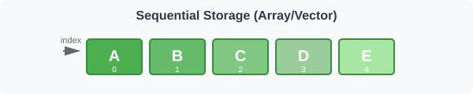
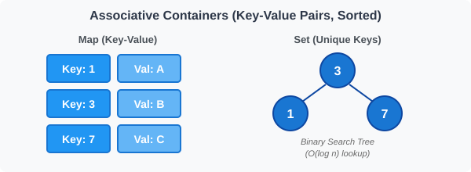
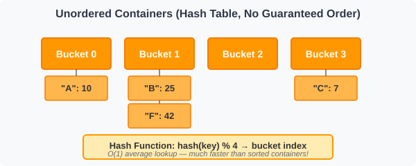
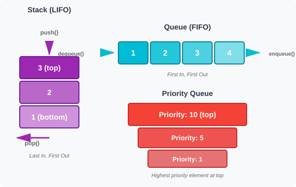

# Collections (Containers) in C++

In C++, collections (also called containers) are objects that store multiple values together, such as numbers, words, or custom objects.

C++ provides ready-to-use containers through the Standard Template Library (STL). Each container is designed for a specific way of storing and accessing data.

> You don't need to understand all of them now, just know that each one has a purpose, and we'll explore them one by one later.

---

## Types of Collections (STL Containers) in C++ :

This section gives an overview of the main **STL container categories** in C++.  
Each container name links to a separate file where it is explained in detail.

### 1. Sequential Containers

These containers store elements **in order**, one after another.

  

| Container | Description | Link |
|---------|------------|------|
| `array` | Fixed-size array | [array](01_sequential_containers/arrays.md) |
| `vector` | Dynamic array that can grow or shrink | [vector](containers/vector.md) |
| `deque` | Dynamic array optimized for both ends | [deque](containers/deque.md) |
| `list` | Doubly linked list | [list](containers/list.md) |
| `forward_list` | Singly linked list | [forward_list](containers/forward_list.md) |
| `string` | Container for text | [string](containers/string.md) |

---

### 2. Associative Containers

These containers store data using **keys**, allowing **fast search & retrieval of elements**.

  

| Container | Description | Link |
|---------|------------|------|
| `set` | Unique, sorted elements | [set](containers/set.md) |
| `multiset` | Sorted elements, allows duplicates | [multiset](containers/multiset.md) |
| `map` | Key–value pairs with unique keys | [map](containers/map.md) |
| `multimap` | Key–value pairs with duplicate keys | [multimap](containers/multimap.md) |

---

### 3. Unordered Associative Containers

These containers provide **fast access** without maintaining order.

  

| Container | Description | Link |
|---------|------------|------|
| `unordered_set` | Unique elements, no order | [unordered_set](containers/unordered_set.md) |
| `unordered_multiset` | Allows duplicates, no order | [unordered_multiset](containers/unordered_multiset.md) |
| `unordered_map` | Key–value pairs, no order | [unordered_map](containers/unordered_map.md) |
| `unordered_multimap` | Key–value pairs with duplicate keys | [unordered_multimap](containers/unordered_multimap.md) |

---

### 4. Container Adapters

These containers **restrict how data is accessed**.

  

| Container | Description | Link |
|---------|------------|------|
| `stack` | Last In, First Out (LIFO) | [stack](containers/stack.md) |
| `queue` | First In, First Out (FIFO) | [queue](containers/queue.md) |
| `priority_queue` | Access elements by priority | [priority_queue](containers/priority_queue.md) |

## Quick Reference Guide

| Category | When to Use | Example Use Case |
|----------|-------------|------------------|
| **Sequential** | Need ordered access and iteration | Shopping list, playlist |
| **Associative** | Need fast lookup with sorted data | Dictionary, phone book |
| **Unordered** | Need fastest lookup, order doesn't matter | Cache, user sessions |
| **Adapters** | Need specialized access patterns | Undo/redo (stack), task queue |