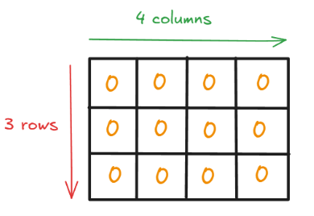
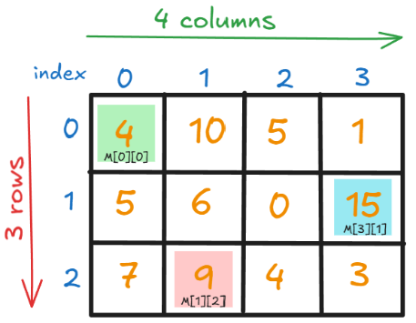

# $\color{Red}{\textrm{Dynamic\ Array\ Data\ Structure }}$

**Dynamic arrays** are arrays whose **size can change during runtime**, with **memory allocated** on the **heap**.

- **heap** : a region of memory used for **dynamic allocation**, where variables persist until they are manually freed or automatically managed.

> In C++, dynamic arrays can be implemented using $\color{orange}{\texttt{std::vector}}$


### Table of Contents
- [Declaration](#coloryellowtextrmdeclaration)
- [Acess an Element](#coloryellowtextrmacess-an-element)
- [Adding an Element](#coloryellowtextrmadding-an-element)
- [Removing Elements](#coloryellowtextrmremoving-elements)
- [Traversal](#coloryellowtextrmtraversal)
- [(Recap) Useful Functions](#coloryellowtextrmrecap-useful-functions)
- [2-Dimentional Arrays](#coloryellowtextrm2-dimentional-arrays)
  - [Declaration](#colortealtextrmdeclaration)
 


## $\color{Yellow}{\textrm{Declaration}}$

### Using `std::vector` :

```c
// #include <vector>  ===> MUST include this library 
// using namespace std;

// empty vector
vector<int> v1; 

// size 5, default values (0)
vector<int> v2(5); 

// size 5, all values = 10
vector<int> v3(5, 10);  

// initializer list
vector<int> v4 = {1, 2, 3}; 
```

```bash
v1 = { }              

v2 = {0, 0, 0, 0, 0} 

v3 = {10, 10, 10, 10, 10} 

v4 = {1, 2, 3}       
```


### Manual dynamic array `new` :

We can also create a dynamic array manually using `new`.
- This allocates memory on the **heap** (free store), not on the stack.

```cpp
// allocate array of size 5
int* arr = new int[5];

// asign a value 
arr[0] = 12 ;

// Releases the memory allocated by new 
delete[] arr;
```

### ⚠️ IMPORTANT :

* Since we **manually allocate memory**, we must also **manually free it** to avoid **memory leaks**.
* Values must be assigned manually


## $\color{Yellow}{\textrm{Acess\ an\ Element}}$

### $\color{teal}{\textrm{Acess\ first\ and\ last\ element}}$

- **`.front()`** : to access the first element
- **`.back()`** : to access the last element

```cpp
vector<int> v = {3, 2, 1}; 

v.front() ; // 3 
v.back() ;  // 1 
```

### $\color{teal}{\textrm{Access and element at index `i`}}$

- Element can be accessed using their **index**.
- Element can also be accessed using the function **`.at()`**

```cpp
vector<int> v = {3, 2, 1}; 

v[0];        
v.at(0);     
```

```bash
3
3
```


### ⚠️ IMPORTANT :

* `v[i]` does **not check bounds**, so accessing an invalid index may return garbage or cause undefined behavior.
* `v.at(i)` is **safer** because it checks bounds and throws an error if the index is invalid.


```cpp
vector<int> v = {3, 2, 1}; 

v[6];        // return random number
v.at(6);     // ❌ return Error 
```


## $\color{Yellow}{\textrm{Adding\ an\ Element}}$

### Add element at the back `.push_back()` :

```cpp
vector<int> v = {3, 2, 1}; 

// adding elemnt at the back 
v.push_back(10); 
```

```bash 
v = {3, 2, 1, 10}
```


### Add element at index `i` :

Using `.insert( iterator , value)`
- `iterator` → position where you insert
- `value` → element to add

```cpp
vector<int> v = {3, 2, 1}; 

// insert 10 at index 1
v.insert(v.begin() + 1, 10);
```

```bash
v = {3, 10, 2, 1}
```

* `v.begin()` returns an iterator to the first element
* `v.begin() + i` points to index `i`
* `insert(position, value)` adds the element at that position


## $\color{Yellow}{\textrm{Removing\ Elements}}$

- **`.pop_back()`** : Used to **delete the last element**.
    - Here the array size will change, it will shrink by one. 
- **`.clear`** : **Delete all elements**, the array become **empty.**

```cpp
vector<int> v = {3, 8, 1, 4}; 

// remove last elment => {3, 8, 1} 
// array size => 3
v.pop_back(); 

// Remove all elements => { }
v.clear()
```


- **`.erase(index)`** : **Delete an element in index `i`**.
    - All elements after index `i` will be shifted left by one position.

```cpp
vector<int> v = {3, 8, 1, 4}; 

// Remove the first element : => {8, 1, 4}
v.erase(v.begin());

// Remove element at index i (2) => {3, 8, 4}
// v.erase(v.begin() + i)
v.erase(v.begin() + 2)
```


## $\color{Yellow}{\textrm{Traversal}}$

### Method 1 : index-based traversal 

- In this case, the **`size`** of the array must be known.
    - **`.size()`** : is used to get size of array 

```cpp
vector<int> v = {3, 2, 1, 4}; 

for (int i = 0; i < v.size(); i++) {
    cout << v[i];
}
```

```
3 2 1 4
```

### Method 2 : range-based traversal 

- No need to know the **`size`** of array.

```cpp
vector<int> v = {3, 2, 1, 4}; 

for (int x : v) {
    cout << x;
}
```

```
3 2 1 4
```


## $\color{Yellow}{\textrm{(Recap) Useful\ Functions}}$

A collection of useful functions :

### $\color{teal}{\textrm{Size\ and capacity}}$

- **Size** : the number of elements currently stored in the vector  
- **Capacity** : the amount of memory allocated by the vector (**how many elements it can hold before resizing**)

| Function        | Description |
|----------------|------------|
| `v.size()`     | Number of elements |
| `v.capacity()` | Allocated memory (capacity) |
| `v.empty()`    | Returns true if empty |
| `v.resize(n)`  | Change size to `n` |
| `v.reserve(n)` | Allocate capacity without changing size |


### $\color{teal}{\textrm{Element\ Access}}$


| Function        | Description |
|----------------|------------|
| `v[i]`         | Access element (no bounds check) |
| `v.at(i)`      | Access with bounds check |
| `v.front()`    | First element |
| `v.back()`     | Last element |

### $\color{teal}{\textrm{Iterators}}$

| Function        | Description |
|----------------|------------|
| `v.begin()`    | Iterator to first element |
| `v.end()`      | Iterator to one past last |
| `v.rbegin()`   | Reverse iterator (last element) |
| `v.rend()`     | Reverse end |

### $\color{teal}{\textrm{Modifiers}}$

| Function              | Description |
|----------------------|------------|
| `v.push_back(x)`     | Add element at end |
| `v.emplace_back(x)`  | Construct element at end |
| `v.pop_back()`       | Remove last element |
| `v.insert(pos, x)`   | Insert at position |
| `v.erase(pos)`       | Remove element |
| `v.clear()`          | Remove all elements |


## $\color{Yellow}{\textrm{2-Dimentional\ Arrays}}$

- Until now, we've only dealt with **1-dimensional arrays**
- Now we introduce **multi-dimensional arrays** (also called **matrices**)

--- 

### $\color{orange}{\textrm{Declaration}}$

```cpp
// matrix with 3 rows × 4 columns, all elements = 0
vector<vector<int>> M(3, vector<int>(4, 0));

// matrix with 3 rows × 4 columns
// elme,t are intialised with default value (0).
vector<vector<int>> M(3, vector<int>(4));
```

<div align="center "> 



</div>

- If the **matrix size is not known** in advance, you can **declare it first** and **resize it later**.

```cpp
// declare first, then resize
vector<vector<int>> M;
M.resize(3, vector<int>(4, 0));
```


---

### $\color{orange}{\textrm{Access an element}}$

* To access an element in a 2D array, we use **`two indices`**, not just one :

  * **First index `i`** → represents the **row**
  * **Second index `j`** → represents the **column**
  * Access pattern: **`[row][column]`**

* Since it is a **2D array**, exactly **two indices** are required to locate any element


```cpp
vector<vector<int>> M(3, vector<int>(4));

M[0][0] ;
M[1][2] ;
M[3][1] ;
```

<div align="center "> 



</div>

---

### $\color{orange}{\textrm{Traversal}}$

- A **`for loop`** can be used to iterate through an matrix
    - `M.size()` → number of rows
    - `M[i].size()` → number of columns in `row i`

```cpp
vector<vector<int>> M(3, vector<int>(4, 0));

// get rows & cols :
int rows = M.size();     // => 3
int cols = M[0].size();  // => 4
```


#### **Index-based loop :**
```cpp
vector<vector<int>> M(3, vector<int>(4, 0));


// Loop through the rows :
for (int i=0 ; i < M.size() ; i++) {
    // Loop through the columns :
    for (int j=0 ; j< M[i].size() ; j++){
        cout << M[i][j] ;
    }
}
```

#### **Range-based loop :**
```cpp
vector<vector<int>> M(3, vector<int>(4, 0));


// Loop through the rows :
for (auto &row : M) {
    // lopp through the columns
    for (auto &val : row) {
        cout << val << " ";
    }
    cout << endl;
}
```


--- 


