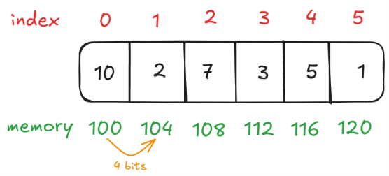

# ${\color{Red}Static \space Arrays \space data \space Structure }$ 

An array is a fundamental and **linear** data structure that stores items at contiguous memory locations. It stores multiple **elements of the same type**.
- **linear**: The elements are stored one after another in a single sequence.
- **contiguous**: The elements are stored next to each other in memory, with no gaps between them.


| ✅ Advantages | ❌ Downsides |
|---|---|
| **O(1) random access**<br>Access any element instantly using its index. | **Fixed size**<br>The size is determined when the array is created. (**only for static arrays**) |
| **Cache friendly**<br>Contiguous memory improves CPU cache performance. | **Costly insertions/deletions**<br>Elements must be shifted (*O(n)*). |
| **Simple**<br>Easy to understand and implement. | **Requires contiguous memory**<br>Large arrays may be difficult to allocate. |
| **Low memory overhead**<br>No extra pointers are required. | **Same data type**<br>All elements must have the same type. |


## ${\color{yellow}Declaration \space of \space an \space Array }$ 


- Syntaxe

```cpp
data_type array_name[size];
```

- Example 

```c
// Array to store integer values :
int arr[5];      

// Array to store char values : 
char arr[10];   

// An array  of strings : 
string arr[12];
```


## ${\color{yellow}Initializing \space of \space an \space Array }$ 

Arrays can be initialized in several ways.


```c
// Initialize while declaring the array 
char arr[5] = { 'a', 'b', 'c', 'd', 'e' };

// Let the compiler determine the size
int arr[] = { 1, 2, 3, 4, 5 };

// Partial initialization
string arr[10] = { "hello", "world", "!"};

// Empty initialization 
int arr[5] = {}; 
```


## ${\color{yellow}Accessing \space Elements}$ 

Each element is accessed using its **index**.

```c
int arr[] = {10, 2, 7, 1, 3, 5, 1} ;

cout << arr[0]; // 10
cout << arr[1]; // 2
cout << arr[5]; // 1
cout << arr[10]; // ❌ will return a random number 
```

- The **first** element has index **0**.
- The **last** element has index **size - 1**.


<div align="center"> 



</div>

> Notice that each address increases by **4 bytes** because an `int` usually occupies 4 bytes.


## ${\color{yellow} \space Change \space Elements}$

Elements can be changed using their index.

```cpp
int arr[] = {5, 10, 15};

arr[1] = 100;   
```

- The array becomes :
```py 
5 100 15 
```


## ${\color{yellow}Traversing \space an \space Array}$

The most common way to traverse every element is with a **loop**.

```c
int arr[] = {3, 5, 7, 9, 11};

// Get size of static array :
int size = sizeof(arr) / sizeof(arr[0]);

for (int i = 0; i < size; i++)
{
    cout << arr[i] << " ";
}
```


```c
int arr[] = {3, 5, 7, 9, 11};

// using a foreach loop 
for (int num : arr){
    cout << num  << " ";
}
```

```bash 
3 5 7 9 11
```


https://www.geeksforgeeks.org/dsa/array-data-structure-guide/


