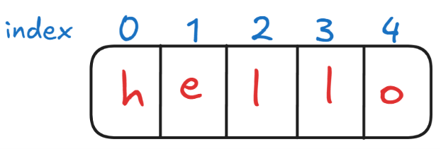

# $\color{Red}{\textrm{Strings }}$


> At the data structure level, a string is often implemented using an array, but a string is considered its own data structure/ADT (Abstract Data Type) because it has extra rules and operations.


* Strings are **mutable** (you can change characters)
* Internally behave like **dynamic arrays of characters**
* But they provide **extra built-in operations**
* That’s why they are treated as an **ADT(Abstract Data Type), not just a simple array**


## $\color{Yellow}{\textrm{Basics}}$

* A **string** is a sequence of characters
* In C++, we use the `string` type from the STL

```cpp
#include <string>
using namespace std;

string s = "hello world !";
```


## $\color{Yellow}{\textrm{Accessing Characters}}$

* Similar to **arrays**, we can use `indexing`.
    * Indexing starts from `0`
    * Last index = `size() - 1`

```cpp
string s = "hello";

cout << s[0]; // h
cout << s[1]; // e
```

<div align="center "> 



</div>


## $\color{Yellow}{\textrm{Common Operations}}$

### Size of string

```cpp
string s = "hello";

cout << s.size(); // 5
```


### Concatenation (joining strings)

```cpp
string a = "hello";
string b = "world";

string c = a + " " + b; // "hello world"
```


### Adding characters

```cpp
string s = "abc";

s.push_back('d'); // "abcd"
```


### Removing characters

```cpp
string s = "abcd";

s.pop_back(); // "abc"
```


### Substring

* `substr(start, length)`

```cpp
string s = "hello";

cout << s.substr(1, 3); // "ell"
```


## $\color{Yellow}{\textrm{Traversal}}$

### index-based loop :

```cpp
string s = "hello";

for (int i = 0; i < s.size(); i++) {
    cout << s[i] << " ";
}
```


### Range-based loop :

```cpp
for (char c : s) {
    cout << c << " ";
}
```


## $\color{Yellow}{\textrm{Comparison}}$

```cpp
string a = "abc";
string b = "abc";

if (a == b) {
    cout << "Equal";
}
```


