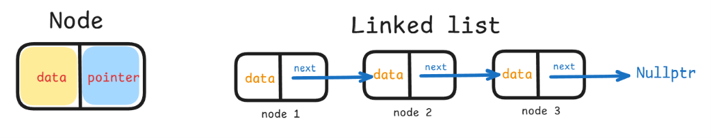
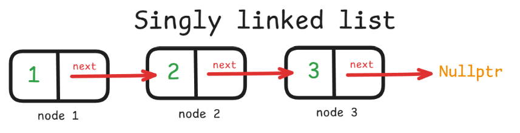
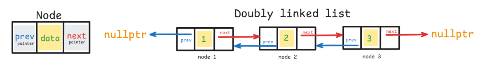
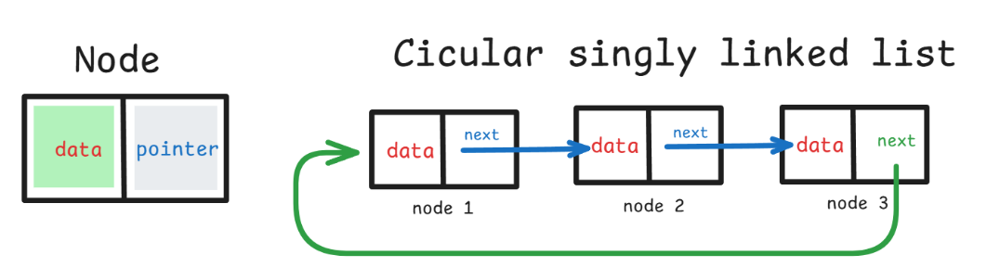
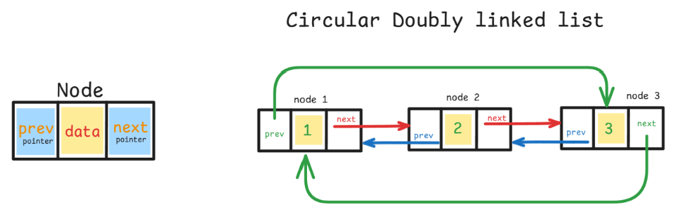

# $\color{Red}{\textrm{Linked lists}}$

#### ⚠️ $\color{Cyan}{\textrm{Prerequisites :}}$

- Before learning linked lists, you should be comfortable with: **`Pointers`**, **`dereferencing`** and **`dynamic memory allocation`**.
- These concepts are **crucial** to understand how linked lists work internally.
- [👉 pointers guide](/01_core_concepts/pointers/README.md)

 

## $\color{yellow}{\textrm{What is a Linked List?}}$

### $\color{Cyan}{\textrm{Definition}}$

- A **`linked list`** is a **`linear data structure`** made of individual **`nodes`** :
- Each **`node`** stores : 
    1. A piece of **Data** 
    2. A **`pointer`** (point to the next node in sequence)

 

- For the last node, the **`next`** pointer points to **`nullptr`**, which indicates the **end of the linked list**.

- Unlike **arrays**, the elements are **not stored in contiguous memory**. Instead, each node **points** to the next node, forming a chain.

## $\color{yellow}{\textrm{Advantages vs. Downsides}}$

- A **linked list** stores a sequence of elements in **non-contiguous memory**. Unlike **arrays**, its elements are connected using pointers instead of being stored next to each other in memory.

| ✅ Advantages | ❌ Downsides |
| :--- | :--- |
| **Efficient** insertion and deletion of **nodes**. | No **direct** (`random`) access to elements by **index**. |
| **Size** can **grow** or **shrink** dynamically. | Extra **memory** is required for the `next` pointer. |
| Does **not** require `contiguous memory`. | **Traversal** is slower because nodes are **scattered** in memory. |
| No need to **shift** elements after **insertion** or **deletion.** | Cannot access an element by **index** without **traversing** the list. |

## $\color{Yellow}{\textrm{Types of Linked Lists}}$

There are several types of linked lists :

### $\color{Cyan}{\textrm{1. Singly linked list}}$

A **singly linked list** is a linked list where each node stores 
- **data** 
- `next` pointer that points to the **next node** in the list.

 

 

### $\color{Cyan}{\textrm{2. Doubly linked list}}$

A **doubly linked list** is a linked list where each node stores :
- **data**, 
- `next` pointer to the **next node**,
- `prev` pointer to the **previous node**. 

This allows traversal in **both directions**.

 

 

### $\color{Cyan}{\textrm{3. Circular Linked List}}$
A **circular linked list** is a linked list where : 
- the **last node** points back to the **first node** instead of `nullptr`, forming a **circle**. 

It can be implemented as either a **singly** or **doubly** linked list.

 

 

 

 

### Quick recap :

- **Singly** vs. **Doubly** → describes how many pointers each node has.

- **Circular*** vs. **Non-circular** → describes how the last node is connected.