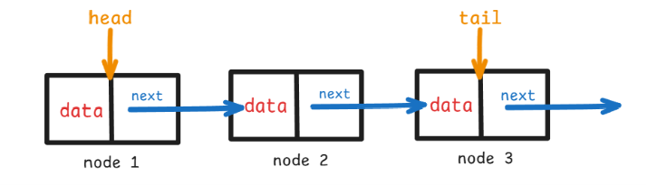
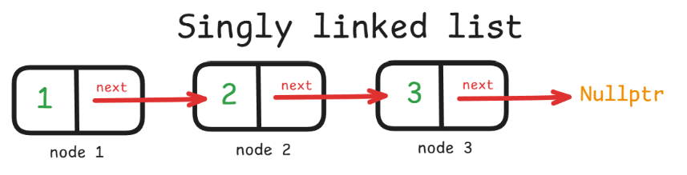
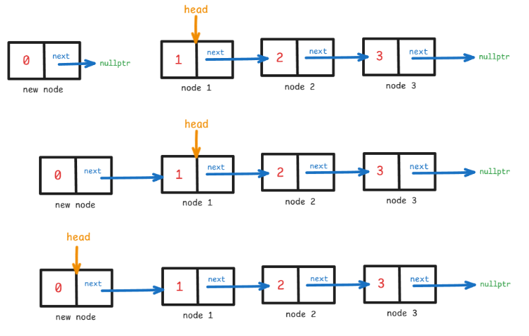
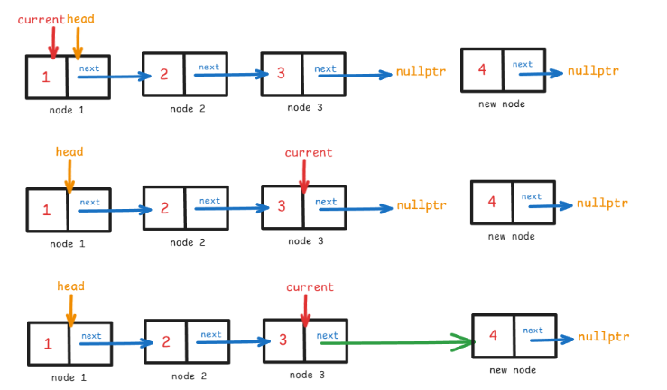
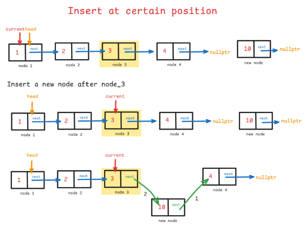

# $\color{Red}{\textrm{Singly Linked lists}}$

<div align="center "> 


</div>

### Table of Contents
- [Head and Tail](#coloryellowtextrmhead-and-tail)
- [Declaration and Construction](#coloryellowtextrmdeclaration-and-construction)
- [Traversing a List](#coloryellowtextrmtraversing-a-list)
- [Getting the Size](#coloryellowtextrmgetting-the-size)
- [Inserting Elements](#coloryellowtextrminserting-elements)
- [Deleting an Element](#coloryellowtextrmdeleting-an-element)


## $\color{yellow}{\textrm{Head and Tail}}$

Before working with linked lists, we need to understand two important pointers: 


- **$\color{Cyan}{\textrm{Head}}$** : A pointer that stores the **`address`**address of the **`first node`** in the linked list.
    - It is the entry point used to access the entire list.
    - If the list is empty, `head` points to `nullptr`.


- **$\color{Cyan}{\textrm{Tail}}$** A pointer that stores the **`address`**address of the **`last node`** in the linked list.
  
<br>

<div align="center "> 



</div>


## $\color{yellow}{\textrm{Declaration and Construction}}$

Each **`node`** stores : 
1. A piece of **Data** 
2. A **`next` (pointer)** → point to the next node in sequence.

<br>

### $\color{cyan}{\textrm{Defining a Node in C++}}$


- In C++, we use a **`struct`** to define a node. 
- A **`struct`** is data type that groups different variable under one name.
- The **`struct`** allows us to combine the **`data`** and the **`next` (pointer)** into a single object (node).

<br>

```cpp
struct Node {
    int data;       // Stores a value
    Node* next;     // Pointer to the next node
};
```


### $\color{cyan}{\textrm{Node Construction}}$


- After defining the `Node` structure, we need a way to create and initialize new nodes.

A **constructor** is a special function inside a `struct` that is automatically called when a new object is created. It allows us to initialize the node's **data** and set the `next` pointer.


```cpp
struct Node {
	int data;
	Node* next;

	// Default constructor :
	Node() : data(0) , next(nullptr) {}

	// Constructor to set only the value :
	Node(int x) : data(x) , next(nullptr) {}

	// Contructor to set the value and next pointer :
	Node(int x , Node* ptr) : data(x) , next(ptr) {}

} ;
```


### $\color{cyan}{\textrm{Example : creating a linked list}}$


<div align="center "> 



</div>


```cpp
int main(){

	// Create the node_3 : 
    // data=3 , next->nullptr
	Node *node3 = new Node(3) ;

	// Create the node_2 :
    // data=2 , next->node_3
	Node *node2 = new Node(2, node3) ;

    // Create the node_1 :
    // data=1  next->node_2
    Node *node1 = new Node(1, node2) ;

}

```


## $\color{yellow}{\textrm{Traversing a List}}$

- For traversal, we use the **`head` pointer** that points to the first node.

- Usually, the **`head` pointer is provided** as the starting point of the traversal.

- A good practice is to **avoid modifying `head` directly**. Instead, we create a temporary pointer `current` and assign `head` to it.

- The `current` pointer moves through the list node by node using `current->next`.

- After the traversal is complete, `current` reaches `nullptr`, while the original **`head` pointer remains unchanged**.

<br>

```cpp
void traverse(Node* head) {

    // Create a temporary pointer starting from head
    Node* current = head;

    // Traverse the list
    while (current != nullptr) {

        // Print the current node data
        cout << current->data << "  ";

        // Move to the next node
        current = current->next;
    }
}
```


## $\color{yellow}{\textrm{Getting the Size}}$

- To get the **size of a linked list**, we need to **traverse the entire list** and count the number of nodes.

- We start from the **`head` pointer** and use a temporary pointer (`current`) to move through the list.

<br>

```cpp
int size(Node* head) {

    // // Create a temporary pointer starting from head
    Node* current = head;

    int count = 0;

    // travers the list 
    while (current != nullptr) {
        count++;
        current = current->next;
    }

    return count;
}
```


## $\color{yellow}{\textrm{Inserting Elements}}$


### $\color{Cyan}{\textrm{Insert at the Front}}$


- Adding a **new node at the beginning** is simple.
    1. Create the new node.
    2. Make it point to **`head`(previous first node)**
    2. Update the **`head` pointer** to point to the new node. 

<br>

<div align="center "> 



</div>

```cpp
void add_front(int val, Node* head) {

    // Create a new node 
    Node* newNode = new Node(val);

    // 
    newNode->next = head;

    // Update head to point to the new first node
    head = newNode;
}
```


### $\color{Cyan}{\textrm{Insert at the End}}$


- Adding a **new node at the end** requires traversing the list to find the last node.
    1. Create the new node.
    2. Traverse the list until reaching the **last node**.
    3. Update the last node's **`next` pointer** to point to the new node.

> Usually **`tail`** pointer is not provided, so we have to traverse the list to reach last node. 

<div align="center "> 



</div>

```cpp
void add_back(int val, Node* head) {

    // Create a new node
    Node* newNode = new Node(val);

    Node* current = head;

    // Traverse to the last node
    while (current->next != nullptr) {
        current = current->next;
    }

    // Link the last node to the new node
    current->next = newNode;
}
```


### $\color{Cyan}{\textrm{Insert at a Certain Position}}$


- Inserting a **new node at a specific position** requires finding the node before that position and updating the links.
    1. Create the new node.
    2. Traverse the list until reaching the node **before the desired position**.
    3. Connect the new node to the next node.
    4. Update the previous node's `next` pointer to point to the new node.


<div align="center "> 



</div>


```cpp
void insert_at_position(int val, int pos, Node* head) {

    // Create a new node
    Node* newNode = new Node(val);

    // Traverse to the node before the position
    Node* current = head;
    for (int i = 1; i < pos; i++) {
        current = current->next;
    }

    // Link the new node with the list
    newNode->next = current->next;
    current->next = newNode;
}
```


## $\color{yellow}{\textrm{Deleting an Element}}$


Deleting a node from a linked list requires updating the pointers to remove the node from the chain, then freeing the memory occupied by that node.

### $\color{Cyan}{\textrm{Delete from the Front}}$

- Removing the first node is the simplest deletion operation.
    1. Store the current `head` node.
    2. Move `head` to the next node.
    3. Delete the old first node.

```cpp
void delete_front(Node*& head) {

    // Store the first node
    Node* temp = head;

    // Move head to the next node
    head = head->next;

    // Delete the old first node
    delete temp;
}
```


### $\color{Cyan}{\textrm{Delete from the End}}$


* Removing the last node requires finding the node before the last one.

  1. Traverse until reaching the second-to-last node.
  2. Delete the last node.
  3. Set the second-to-last node's `next` pointer to `nullptr`.

```cpp
void delete_back(Node*& head) {

    // Traverse to the second-last node
    Node* current = head;

    while (current->next->next != nullptr) {
        current = current->next;
    }

    // Delete the last node
    delete current->next;

    // Mark the new end of the list
    current->next = nullptr;
}
```


### $\color{Cyan}{\textrm{Delete at a Certain Position}}$


* Deleting a node at a specific position requires reaching the node before it.

  1. Traverse to the node before the target node.
  2. Store the node to be deleted.
  3. Update the previous node's `next` pointer.
  4. Delete the target node.

```cpp
void delete_at_position(int pos, Node*& head) {

    // Traverse to the node before the target
    Node* current = head;

    for (int i = 1; i < pos; i++) {
        current = current->next;
    }

    // Store the node to delete
    Node* temp = current->next;

    // Skip the deleted node
    current->next = temp->next;

    // Free memory
    delete temp;
}
```


