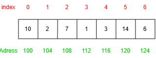

# Array Data Structure : 

An array is a fundamental and **linear** data structure that stores items at contiguous memory locations. It stores multiple **elements of the same type**.
- **linear**: The elements are stored one after another in a single sequence.
- **contiguous**: The elements are stored next to each other in memory, with no gaps between them.


### Example : 

```cpp
int arr[] = {10, 2, 7, 1, 3, 14, 16}
```
Each element occupies a consecutive memory location. 
- Since an **int usually takes 4 bytes**, **the address increases by 4 for every new element**.

<div align="center"> 



</div>


## Declaration of an Array : 


```bash
int arr[5]
```

