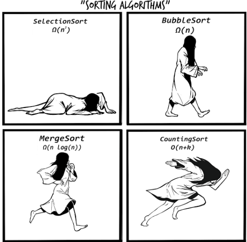

# $\color{Red}{\textrm{Sorting Algorithms}}$

 

Sorting is the problem of taking a collection of elements (array, vector, list, etc.) and rearranging them into a specific order, typically ascending or descending. It is one of the most fundamental and heavily studied problems in computer science.

There is no single "correct" way to solve this problem — a great number of algorithms exist that all sort correctly, but differ in how they get there. What actually matters, and what separates one algorithm from another, is complexity: how the number of operations and the memory used grow as the input gets larger. Two algorithms can produce the exact same sorted output while behaving completely differently in terms of speed and resource usage, and that difference is the whole point of studying more than one.

This guide serves as an overview of the most common sorting algorithms. Each algorithm gets its own dedicated file with a full explanation, step-by-step walkthrough, and compilable C++ implementation. This page only summarizes what exists and how they compare — not how they work internally.

 

## $\color{Yellow}{\textrm{Table of Contents}}$

- [Introduction](#introduction)
- [What Makes a Sorting Algorithm](#what-makes-a-sorting-algorithm)
- [Common Sorting Algorithms](#common-sorting-algorithms)
- [Choosing the Right Algorithm](#choosing-the-right-algorithm)
- [What is Next](#what-is-next)

 

## $\color{Yellow}{\textrm{What Makes a Sorting Algorithm}}$

When comparing sorting algorithms, a few properties matter more than just "how fast is it":

- **Time Complexity** — how the number of operations grows with input size, usually given for best, average, and worst case.
- **Space Complexity** — how much extra memory the algorithm needs beyond the input itself.
- **Stability** — whether elements that compare as equal keep their original relative order after sorting.
- **In-Place** — whether the algorithm sorts using only a small, constant amount of extra memory, without allocating a second structure proportional to the input size.
- **Adaptive** — whether the algorithm runs faster on data that is already partially sorted.

These properties are what the comparison table below is built from.

 

## $\color{Yellow}{\textrm{Common Sorting Algorithms}}$

These are the most commonly taught and used sorting algorithms. Each will have its own dedicated guide.

| # | Algorithm | Tagline | Time Complexity (Average) |
|---|-----------|---------|:--------------------------:|
| 1 | **Bubble Sort** | Repeatedly swaps adjacent out-of-order elements until the list is sorted | O(n²) |
| 2 | **Selection Sort** | Repeatedly selects the smallest remaining element and places it in position | O(n²) |
| 3 | **Insertion Sort** | Builds the sorted list one element at a time by inserting into its correct place | O(n²) |
| 4 | **Merge Sort** | Divides the list into halves, sorts each recursively, then merges them | O(n log n) |
| 5 | **Quick Sort** | Partitions the list around a pivot and recursively sorts each side | O(n log n) |
| 6 | **Heap Sort** | Builds a heap from the data and repeatedly extracts the maximum | O(n log n) |

More advanced or less common algorithms (Shell Sort, Counting Sort, Radix Sort, Bucket Sort, Tim Sort, etc.) will be introduced in a later, separate guide once these foundational ones are covered.

 

## $\color{Yellow}{\textrm{Choosing the Right Algorithm}}$

- Small or nearly-sorted input → **Insertion Sort** is often fastest in practice despite its quadratic average case.
- Guaranteed O(n log n) with predictable performance → **Merge Sort**.
- Fast average-case performance and low memory overhead → **Quick Sort**.
- Guaranteed O(n log n) with minimal extra space → **Heap Sort**.
- Teaching or illustrating basic sorting mechanics → **Bubble Sort** or **Selection Sort**.

Real-world standard library sorts (like C++'s `std::sort`) are usually hybrids of several of these strategies, chosen dynamically based on input size and structure.

 

## $\color{Yellow}{\textrm{What is Next}}$

Each algorithm listed above will get its own dedicated file covering:

- Step-by-step explanation of how it works
- Visual/manual walkthrough of an example
- Full compilable C++ implementation
- Complexity analysis specific to that algorithm