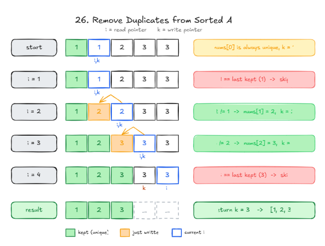

<h1 align="center">26. Remove Duplicates from Sorted Array</h1>

<div align="center">

[](https://leetcode.com/problems/remove-duplicates-from-sorted-array/)


</div>

<br>

You get an array sorted in non-decreasing order. Remove the duplicates **in-place** so each value appears once, keeping the original order.
Return `k`, the number of unique values. Only the first `k` slots matter; what's left after them doesn't.

```
Input:  nums = [1, 1, 2, 3, 3]
Output: k = 3, nums = [1, 2, 3, _, _]
```

<br>

## ${\color{#FFA116}\textsf{Intuition}}$
Because the array is **sorted**, duplicates always sit next to each other. So a value is "new" only if it's different from the **last unique value we kept**.

We use two pointers on the same array:
- `i` (**read**) scans every element.
- `k` (**write**) points to the slot where the next unique value goes.

When `nums[i]` is new, we copy it to `nums[k]` and move `k` forward. Duplicates are simply skipped and later overwritten.

<br>

## ${\color{#FFA116}\textsf{Visual\ walkthrough}}$

<p align="center"></p>

`nums = [1, 1, 2, 3, 3]`, start with `k = 1` (the first element is always unique)

```
 i | nums[i] | last kept (nums[k-1]) | new? | action          | array after       | k
---+---------+-----------------------+------+-----------------+-------------------+---
 1 |    1    |          1            |  no  | skip            | [1, 1, 2, 3, 3]   | 1
 2 |    2    |          1            | YES  | nums[1] = 2     | [1, 2, 2, 3, 3]   | 2
 3 |    3    |          2            | YES  | nums[2] = 3     | [1, 2, 3, 3, 3]   | 3
 4 |    3    |          3            |  no  | skip            | [1, 2, 3, 3, 3]   | 3
```

Result: `k = 3`, first 3 slots are `[1, 2, 3]` ✅

```
   k (write)
   ↓
[1, 2, 3 | 3, 3]
           ↑
    leftovers (ignored)
```

<br>

## ${\color{#FFA116}\textsf{Approaches}}$
| Approach | Idea | Time | Space |
|----------|------|:----:|:-----:|
| Extra set | Put values in a `set`, copy them back | O(n log n) | O(n) |
| Two pointers ✅ | Read with `i`, write unique values at `k` | O(n) | O(1) |

The set version works, but it uses extra memory, and the problem asks for **in-place**.

<br>

## ${\color{#FFA116}\textsf{Edge\ cases}}$
- **Single element:** `[7]` → `k = 1`, nothing to remove.
- **All the same:** `[2, 2, 2]` → `k = 1`, result `[2]`.
- **No duplicates:** `[1, 2, 3]` → `k = 3`, each value overwrites itself.
- **Negative numbers:** `[-3, -3, 0]` works the same, since we only compare values.

<br>

## ${\color{#FFA116}\textsf{Related\ problems}}$
- [283. Move Zeroes](../0283-move-zeroes/problem.md): same read/write pointer idea
- [27. Remove Element](https://leetcode.com/problems/remove-element/): remove a given value instead of duplicates
- [80. Remove Duplicates from Sorted Array II](https://leetcode.com/problems/remove-duplicates-from-sorted-array-ii/): allow each value up to twice (compare with `nums[k-2]`)