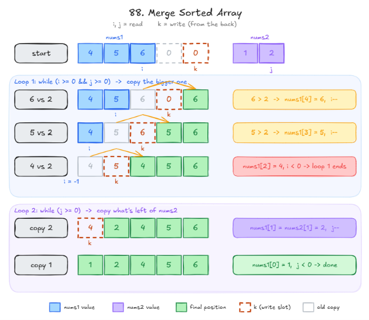

<h1 align="center">88. Merge Sorted Array</h1>

<div align="center">

[](https://leetcode.com/problems/merge-sorted-array/)


</div>

<br>

You get two sorted arrays. `nums1` has `m` real values followed by `n` empty slots (zeros), and `nums2` has `n` values.
Merge `nums2` into `nums1` **in-place** so that `nums1` ends up fully sorted.

```
Input:  nums1 = [4, 5, 6, 0, 0], m = 3
        nums2 = [1, 2],          n = 2
Output: nums1 = [1, 2, 4, 5, 6]
```

<br>

## ${\color{#FFA116}\textsf{Intuition}}$
Merging from the **front** is a problem: writing into `nums1[0]` would overwrite values of `nums1` we haven't used yet.

But the **back** of `nums1` is empty. So we merge from the end, picking the **bigger** value each time and writing it into the last free slot.

Three indexes:
- `i` (**read**) → last real value of `nums1`
- `j` (**read**) → last value of `nums2`
- `k` (**write**) → next slot to fill, starting at `m + n - 1`

Two loops:
1. **While both arrays have values:** copy the bigger of `nums1[i]` and `nums2[j]` to `nums1[k]`.
2. **If `nums1` finished first:** copy what's left of `nums2`.
   If `nums2` finished first, there's nothing to do. The rest of `nums1` never moved, so it's already in place.

<br>

## ${\color{#FFA116}\textsf{Visual\ walkthrough}}$

<p align="center"></p>

`nums1 = [4, 5, 6, 0, 0]`, `nums2 = [1, 2]`

```
loop | nums1[i] | nums2[j] | bigger | write to  | nums1 after       |  i |  j | k
-----+----------+----------+--------+-----------+-------------------+----+----+---
start|          |          |        |           | [4, 5, 6, 0, 0]   |  2 |  1 | 4
  1  |    6     |    2     |   6    | nums1[4]  | [4, 5, 6, 0, 6]   |  1 |  1 | 3
  1  |    5     |    2     |   5    | nums1[3]  | [4, 5, 6, 5, 6]   |  0 |  1 | 2
  1  |    4     |    2     |   4    | nums1[2]  | [4, 5, 4, 5, 6]   | -1 |  1 | 1
     |          |          |        |           |  i < 0 → loop 1 ends
  2  |          |    2     |        | nums1[1]  | [4, 2, 4, 5, 6]   | -1 |  0 | 0
  2  |          |    1     |        | nums1[0]  | [1, 2, 4, 5, 6]   | -1 | -1 |-1
```

`j < 0` → done ✅

<br>

## ${\color{#FFA116}\textsf{Approaches}}$
| Approach | Idea | Time | Space |
|----------|------|:----:|:-----:|
| Copy + sort | Copy `nums2` into the tail, then `sort` | O((m+n) log(m+n)) | O(1) |
| Merge from front | Merge into a new array, copy back | O(m + n) | O(m + n) |
| Merge from back ✅ | Write the bigger value into the last free slot | O(m + n) | O(1) |

<br>

## ${\color{#FFA116}\textsf{Edge\ cases}}$
- **`m = 0`:** `nums1 = [0]`, `nums2 = [1]` → loop 1 never runs; loop 2 copies `nums2`.
- **`n = 0`:** nothing to merge; neither loop does anything.
- **All of `nums2` is smaller:** `[4, 5, 6, 0, 0]` + `[1, 2]` → this is the example above. Loop 2 is needed here.
- **`nums2` finishes first:** `[1, 3, 5, 0, 0]` + `[2, 4]` → loop 2 never runs; `1` is already in place.

<br>

## ${\color{#FFA116}\textsf{Related\ problems}}$
- [26. Remove Duplicates from Sorted Array](../0026-remove-duplicates-from-sorted-array/problem.md): another in-place read/write pointer problem
- [977. Squares of a Sorted Array](../0977-squares-of-a-sorted-array/problem.md): also fills the result from the back, largest first
- [21. Merge Two Sorted Lists](../0021-merge-two-sorted-lists/problem.md): the same merge idea on linked lists