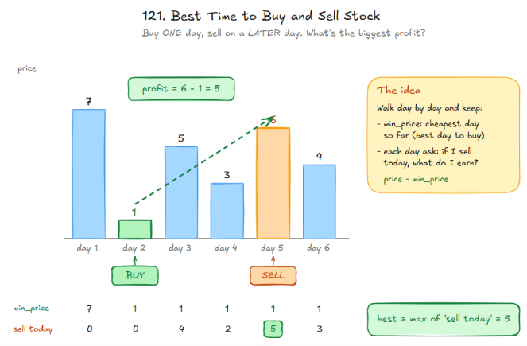

<h1 align="center">121. Best Time to Buy and Sell Stock</h1>

<div align="center">

[](https://leetcode.com/problems/best-time-to-buy-and-sell-stock/)


</div>

<br>

`prices[i]` is the price of a stock on day `i`. You can **buy once** and **sell once, on a later day**.
Return the maximum profit, or `0` if no profit is possible.

```
Input:  prices = [7, 1, 5, 3, 6, 4]
Output: 5          // buy on day 2 (price 1), sell on day 5 (price 6)
```

<br>

## ${\color{#FFA116}\textsf{Intuition}}$
If you sell today, the best you could have done is to have bought at the **cheapest price before today**.

So walk through the days once and keep two values:
- `min_price`: the cheapest price seen so far (the best day to have bought)
- `best`: the best profit seen so far

Each day: update `min_price`, then check `p - min_price`, the profit if we **sell today**.

<br>

## ${\color{#FFA116}\textsf{Visual\ walkthrough}}$

<p align="center"></p>

`prices = [7, 1, 5, 3, 6, 4]`

```
day | price | min_price | sell today (p - min) | best
----+-------+-----------+----------------------+-----
 1  |   7   |     7     |        0             |  0
 2  |   1   |     1     |        0             |  0     ← new cheapest: buy here
 3  |   5   |     1     |        4             |  4
 4  |   3   |     1     |        2             |  4
 5  |   6   |     1     |        5             |  5     ← best sell day
 6  |   4   |     1     |        3             |  5
```

Answer: `5` ✅

<br>

## ${\color{#FFA116}\textsf{Approaches}}$
| Approach | Idea | Time | Space |
|----------|------|:----:|:-----:|
| Brute force | Try every (buy, sell) pair | O(n²) | O(1) |
| One pass ✅ | Track the cheapest price so far; check the profit of selling today | O(n) | O(1) |

<br>

## ${\color{#FFA116}\textsf{Edge\ cases}}$
- **Prices only go down:** `[7, 6, 4, 3, 1]` → `0`. `p - min_price` is never positive, so `best` stays `0`.
- **One day:** `[5]` → `0`. You can't buy and sell.
- **Lowest price comes last:** `[2, 4, 1]` → `2`. The `1` is too late to sell after, but the earlier profit is already saved in `best`.
- `INT_MAX` needs `#include <climits>`.

<br>

## ${\color{#FFA116}\textsf{Related\ problems}}$
- [53. Maximum Subarray](../0053-maximum-subarray/problem.md): same "keep a running value while scanning once" idea (Kadane)
- [122. Best Time to Buy and Sell Stock II](https://leetcode.com/problems/best-time-to-buy-and-sell-stock-ii/): you can buy and sell many times