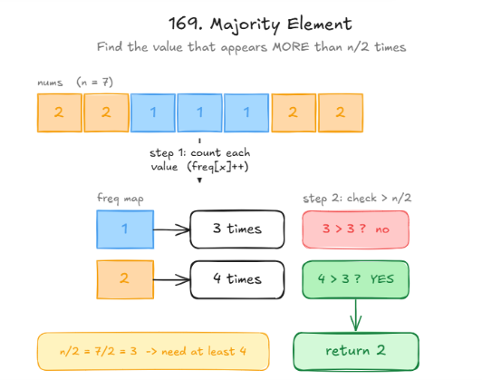

<h1 align="center">169. Majority Element</h1>

<div align="center">

[](https://leetcode.com/problems/majority-element/)


</div>

<br>

Find the value that appears **more than `n / 2` times** in the array. Such a value is guaranteed to exist.

```
Input:  nums = [2, 2, 1, 1, 1, 2, 2]
Output: 2          // 2 appears 4 times, and 4 > 7/2 = 3
```

<br>

## ${\color{#FFA116}\textsf{Intuition}}$
The direct way: **count** how many times each value appears, then return the one whose count is bigger than `n / 2`.

A `map<int, int>` (value → count) does this in two steps:
1. Loop over `nums` and do `freq[x]++`.
2. Loop over the map and return the value with `count > n / 2`.

<br>

## ${\color{#FFA116}\textsf{Visual\ walkthrough}}$

<p align="center"></p>

`nums = [2, 2, 1, 1, 1, 2, 2]`, `n = 7`, `n / 2 = 3`

```
step 1: count                 step 2: check count > 3

 x | freq after                value | count | > 3 ?
---+------------------        -------+-------+------
 2 | {2:1}                       1   |   3   |  no
 2 | {2:2}                       2   |   4   |  YES → return 2 ✅
 1 | {1:1, 2:2}
 1 | {1:2, 2:2}
 1 | {1:3, 2:2}
 2 | {1:3, 2:3}
 2 | {1:3, 2:4}
```

<br>

## ${\color{#FFA116}\textsf{Approaches}}$
| Approach | Idea | Time | Space |
|----------|------|:----:|:-----:|
| Sort | After sorting, the majority is always at index `n / 2` | O(n log n) | O(1) |
| Hash map ✅ | Count each value, return the one with count > n/2 | O(n log n) with `map`, O(n) with `unordered_map` | O(n) |
| Boyer–Moore voting ⭐ | Different values cancel each other; the majority survives | O(n) | O(1) |

**Boyer–Moore in short:** keep a `candidate` and a `count`. When `count` is 0, take the current value as the new candidate. A vote for the same value does `+1`, a different value does `-1`. The majority has more votes than everyone else combined, so it is the one left at the end.

<br>

## ${\color{#FFA116}\textsf{Edge\ cases}}$
- **One element:** `[7]` → `7` (count 1 > 0).
- **Smallest odd case:** `[3, 2, 3]` → `3` (count 2 > 1).
- **Negative numbers:** `[-1, -1, 5]` → `-1`. The map handles any integer key.
- **`> n / 2`, not `>=`:** with `n = 7`, the majority needs **4** appearances, not 3.

<br>

## ${\color{#FFA116}\textsf{Related\ problems}}$
- [1. Two Sum](../0001-two-sum/problem.md): another hash-map problem
- [229. Majority Element II](https://leetcode.com/problems/majority-element-ii/): values appearing more than `n / 3` times (Boyer–Moore with 2 candidates)