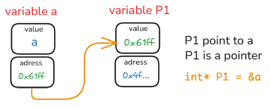

# $\color{Red}{\textrm{Pointers \& Memory managment}}$

- Each **`variable`** has a **`value`** and **`memory adress`**

- **`Pointer`** is a **variable that `stores as value the memory address of another variable`**

<br>

<div align="center "> 



</div>


### Table of Contents

- [Declaration](#coloryellowtextrmdeclaration)
- [Address-of Operator](#coloryellowtextrmaddress-of-operator)
- [Dereferencing](#coloryellowtextrmdereferencing)
- [Null Pointers](#coloryellowtextrmnull-pointers)
- [Pointers and Arrays](#coloryellowtextrmpointers-and-arrays)
- [Pointer Arithmetic](#coloryellowtextrmpointer-arithmetic)
- [Pointers to Pointers](#coloryellowtextrmpointers-to-pointers)
- [Passing by Reference vs Pointer](#coloryellowtextrmpassing-by-reference-vs-pointer)
- [Dynamic Memory Allocation](#coloryellowtextrmdynamic-memory-allocation)
- [Dangling Pointers and Memory Leaks](#coloryellowtextrmdangling-pointers-and-memory-leaks)
- [const with Pointers](#coloryellowtextrmconst-with-pointers)

<br>

## $\color{Yellow}{\textrm{Declaration}}$

* A **pointer** is declared using the `*` symbol.
* It must be declared with the **type** of the variable it will point to.

```cpp
int* p;      // pointer to an int
double* d;   // pointer to a double
char* c;     // pointer to a char
```

> `int* p;` and `int *p;` are **the same thing** the position of `*` doesnt matter.

<br>

## $\color{Yellow}{\textrm{Address-of Operator}}$

* The **`&`** operator returns the **memory address** of a variable.

```cpp
int a = 10;

cout << &a; // prints the address of a, e.g. 0x61ff
```

* We use it to make a pointer point to a variable:

```cpp
int a = 10;
int* p = &a; // p now stores the address of a
```

<br>

## $\color{Yellow}{\textrm{Dereferencing}}$

* The **`*`** operator, when used on a pointer, gives access to the **value stored at the address** it points to.
* This is called **dereferencing**.

```cpp
int a = 10;
int* p = &a;

cout << *p; // 10 -> the variable the pointer point to
cout << p; // the adress of a
cout << &p; // the adress of p
```

```
10
0x7ffe5c424154
0x7ffde7428b0c
```

<br>

## $\color{Yellow}{\textrm{Null Pointers}}$

* A pointer that doesn't point to anything should be set to **`nullptr`**.
* An **nullptr** points to a random/garbage address dereferencing it causes **undefined behavior**.

```cpp
int* ptr = nullptr; // safe, points to nothing
```

* Always check a pointer isn't `nullptr` before dereferencing it.


```cpp
int* ptr;

// Chech if pointer it null
if (ptr != nullptr) {
    cout << *p;
}
```

<br>

## $\color{Yellow}{\textrm{Pointers and Arrays}}$

* An array name can be used as a pointer to its first element, allowing pointer arithmetic to access other elements.

```cpp
int arr[3] = {10, 20, 30};
int* p = arr; // p points to arr[0]

cout << *p;       // 10
cout << *(p + 1); // 20
cout << *(p + 2); // 30
```


<br>

## $\color{Yellow}{\textrm{Pointer Arithmetic}}$


```cpp
int arr[4] = {1, 2, 3, 4};
int* p = arr; // p point to arr[0]

p++;        // now points to arr[1]
p = p + 2;  // now points to arr[3]
p--;        // now points to arr[2]
```

<br>

## $\color{Yellow}{\textrm{Pointers to Pointers}}$

* A pointer can itself be stored in another pointer, using `**`.

```cpp
int a = 10;
int* P1 = &a;
int** P2 = &P1;

cout << **P2; // 10
```

* Useful when a function needs to **modify a pointer itself** (not just the value it points to).

<br>

## $\color{Yellow}{\textrm{Passing by Reference vs Pointer}}$

* Passing by **value** copies the variable => changes don't affect the original.

```cpp
// pass by value 
void passValue(int x){
    x++ ;
}

int a = 5 ;
passValue(a) // 5
```


* Passing by **pointer** or **reference (`&`)** lets a function modify the caller's variable.

```cpp
// pass by reference 
void passReference(int &x){
    x++ ;
}

int a = 5 ;
passReference(a) // 6
```

```cpp
// pass by pointer
void passPtr(int* x){
    (*x)++ ;
}

int a = 5 ;
passPtr(&a) // 6
```

* References are generally preferred in C++ for simplicity, but pointers are still needed when `nullptr` or reassignment is required.

<br>

## $\color{Yellow}{\textrm{Dynamic Memory Allocation}}$

* `new` allocates memory on the **heap** (not the stack), and returns a pointer to it.
* `delete` frees that memory when you're done with it.

```cpp
int* p = new int;   // allocate a single int
*p = 42;
delete p;            // free it
```

* Unlike stack variables, heap memory **stays allocated** until you explicitly `delete` it !

<br>

## $\color{Yellow}{\textrm{Dangling Pointers and Memory Leaks}}$

* A **dangling pointer** points to memory that has already been freed.

```cpp
int* p = new int(5);
delete p;

cout << *p; // undefined behavior! p is dangling
```

* Always set a pointer to `nullptr` right after deleting it:

```cpp
delete p;
p = nullptr;
```

* A **memory leak** happens when you allocate memory with `new` and never `delete` it, the memory stays reserved for the lifetime of the program.

<br>

## $\color{Yellow}{\textrm{const with Pointers}}$

* `const` can be placed in different spots, and each means something different.

    - **`p1`** => is the pointer.
    - **`*p1`** => value of variable it point to.

```cpp
int a = 10;
int b = 20;

const int* p1 = &a;  // pointer to a CONSTANT int:
                      // cannot change *p1, CAN change p1

int* const p2 = &a;  // CONSTANT pointer to an int:
                      // CAN change *p2, cannot change p2

const int* const p3 = &a; // constant pointer to a constant int:
                           // cannot change either
```

<div align="center">

| Declaration | Value changeable? | Pointer reassignable? |
| ----------- | ------------------ | ---------------------- |
| `const int* p` | ❌ | ✅ |
| `int* const p` | ✅ | ❌ |
| `const int* const p` | ❌ | ❌ |

</div>

